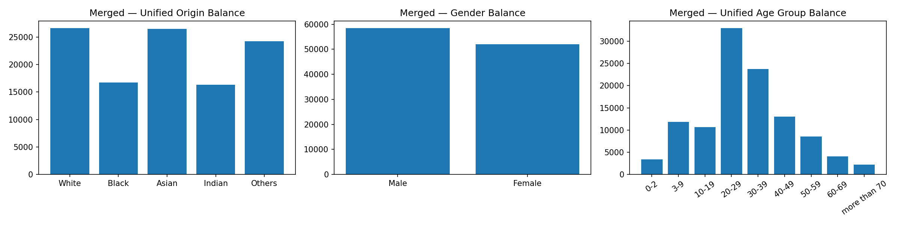
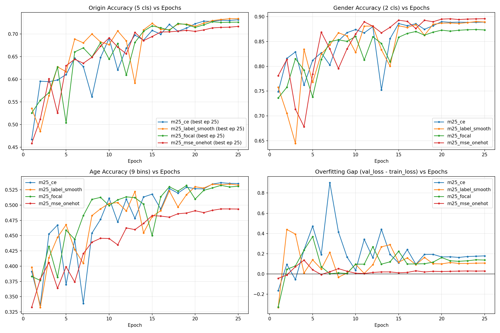
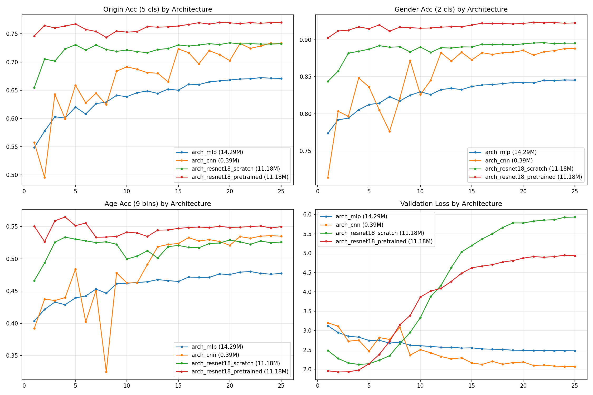
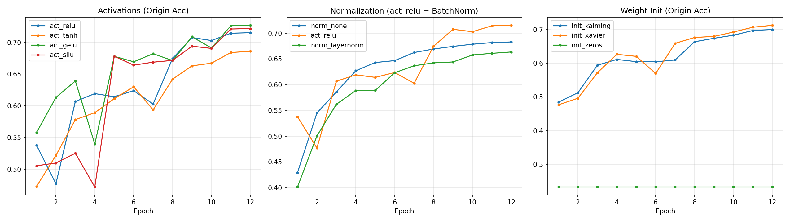
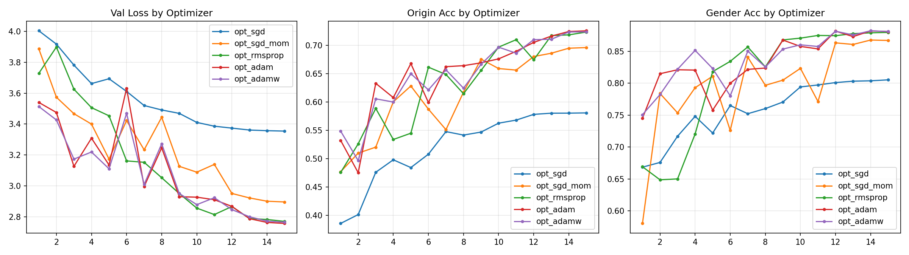
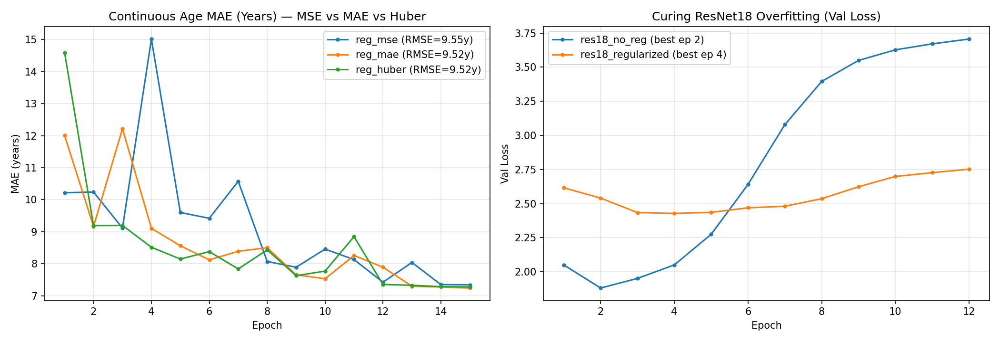
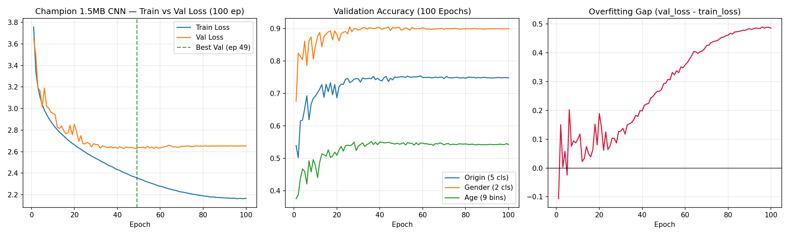

# Face Attribute Supervised Learning Workbench (PyTorch)

**Live In-Browser Demo (100% client-side, 1.51 MB ONNX):** **https://mahmoud-s-khedr.github.io/face-supervised-workbench/**

A modular PyTorch experimentation workbench for multi-task **Origin, Gender, and Age** prediction trained on **121,403 real faces** (merged **FairFace** + **UTKFace**).

Built to study deep learning from first principles by isolating **every layer of a supervised pipeline** into swappable modules and running controlled A/B comparisons across **35+ GPU experiments**.

---

## Modular Architecture (5 Swappable Layers)

| File | Layer | Swappable Options |
| :--- | :--- | :--- |
| `data.py` | **Data, Merge & RAM Caching** | `--dataset fairface \| utkface \| merged \| synthetic`, `--augment none \| basic`, `--cache-dir` (`uint8` RAM cache) |
| `models.py` | **Backbone, Activation, Norm, Init** | `--model mlp \| cnn \| resnet18`, `--activation relu \| tanh \| gelu \| leaky_relu \| silu`, `--norm none \| batchnorm \| layernorm`, `--init default \| kaiming \| xavier \| zeros`, `--dropout` |
| `losses.py` | **Multi-Task Loss Functions** | Classification: `cross_entropy`, `label_smoothing`, `focal`, `mse_onehot`<br>Regression (Age): `mse`, `mae`, `huber` |
| `optimizers.py` | **Optimizers & Schedulers** | `sgd`, `sgd_momentum`, `rmsprop`, `adam`, `adamw` + `none`, `step`, `cosine` |
| `train.py` | **Training & Per-Group Eval** | Explicit 5-step loop, `FastTensorLoader`, `bfloat16` AMP, per-origin accuracy, saves `best_model.pt` & `metrics.json` |
| `predict.py` | **Local CPU Inference** | Run any saved checkpoint on external photos (`--crop 0.68` square face framing) |
| `inspect_data.py` | **Dataset Balance Audit** | Class counts, `max/min` imbalance ratios, distribution charts |
| `compare.py` | **Experiment Comparison** | Side-by-side metrics table + training curve plots |

---

## Merged Dataset (FairFace + UTKFace — 121,403 Images)

* **Split:** `105,708` train / `15,695` validation (zero sample cap).
* **Unified Origin (5 classes, `1.63×` imbalance):** `White` (`24.1%`), `Asian` (`24.0%`), `Others` (`22.0%` — Middle Eastern / Latino_Hispanic / Others), `Black` (`15.2%`), `Indian` (`14.8%`).
* **Gender (2 classes, `1.12×`):** `Male` (`52.9%`), `Female` (`47.1%`).
* **Age:** Supports both 9 unified age bins (`--age-mode classification`, imbalance cut from `30.4× → 14.9×` by merging!) and continuous years (`--age-mode regression`).



---

## Experimental Results (Controlled Layer-by-Layer Ablations)

### 1. Loss Functions (25 Epochs, `393k`-param CNN)
| Loss Function | Origin (5 cls) | Gender (2 cls) | Age (9 bins) | Overfit Gap (`val - tr`) | Key Takeaway |
| :--- | :-: | :-: | :-: | :-: | :--- |
| **`label_smoothing`** | **`73.4%`** | **`88.9%`** | `53.3%` | **`+0.108`** | Best generalization & 40% smaller overfitting gap |
| **`cross_entropy`** | `73.2%` | **`88.9%`** | **`53.5%`** | `+0.179` | Strong baseline |
| **`focal`** | `72.6%` | `87.3%` | `53.1%` | `+0.138` | Best on hardest group (`Others`: `61.9%`) |
| **`mse_onehot`** | `71.7%` | `89.6%` | `49.3%` | `+0.030` | `7×` weaker gradients; starved 9-class Age |



### 2. Architectures (25 Epochs, `cross_entropy`)
| Architecture | Params | Best Ep | Best `val_loss` | End `train → val` | Origin | Gender | Age |
| :--- | ---: | :-: | :-: | :-: | :-: | :-: | :-: |
| **`mlp`** | `14.29M` | 25 | `2.478` | `2.13 → 2.48` | `67.1%` | `84.5%` | `47.7%` |
| **`cnn`** *(scratch)* | **`0.39M`** | 25 | `2.070` | `1.89 → 2.07` | `73.4%` | `88.8%` | `53.5%` |
| **`resnet18`** *(scratch)* | `11.18M` | 4 | `2.124` | `0.006 → 5.93` | `72.3%` | `88.4%` | `53.3%` |
| **`resnet18`** *(pretrained)* | `11.18M` | 2 | **`1.930`** | `0.004 → 4.94` | **`76.5%`** | **`91.2%`** | **`52.7%`** |
| **`resnet18` + Regularization** *(12 ep)* | `11.18M` | 4 | — | `1.41 → 2.75` | **`78.2%`** | **`91.9%`** | **`57.3%`** |



### 3. Activations, Normalization & Weight Initialization (12 Epochs, `cnn`)
* **Activations:** **`gelu`** (`72.7%` Origin / `88.5%` Gender / `52.1%` Age) > `silu` (`72.2%`) > `relu` (`71.5%`) > `tanh` (`68.6%`).
* **Normalization:** **`batchnorm`** (`71.5%`) > `none` (`68.3%`) > `layernorm` (`66.4%`).
* **Initialization:** `default`/`xavier`/`kaiming` (`70–71.5%`) vs. **`zeros`** (`23.3%`, `grad_norm=0.08` — symmetry never breaks!).



### 4. Optimizers (15 Epochs, `cnn`)
* **`adam`** (`72.6%` O / `88.1%` G / `52.4%` A) ≈ **`adamw`** (`72.4%`) ≈ **`rmsprop`** (`72.3%`) > **`sgd_momentum`** (`69.6%`) >> **`sgd`** (`58.1%`).



### 5. Continuous Age Regression (`MSE` vs `MAE` vs `Huber`) & Curing ResNet18 Overfitting
* **`mae` (L1)** won every metric (`7.24y` MAE, `65.7%` Origin, `84.3%` Gender, `grad_norm=28`).
* Unscaled **`mse` (L2)** produced `grad_norm=569`, hijacking the shared CNN backbone and dropping Origin to `43.5%`!



### 6. Champion `1.51 MB` Scratch CNN (100 Epochs — All Winners Combined)
Combining `cnn` (`393k` params) + `gelu` + `batchnorm` + `label_smoothing` + `augment basic` + `adamw` + `cosine` + `bf16 AMP`:
* **Best Epoch (49):** **`75.1%` Origin** (`Asian 88.0%`, `Black 84.3%`, `White 76.7%`, `Indian 63.9%`, `Others 59.0%`) · **`90.4%` Gender** · **`54.4%` Age** (`55.0%` peak) — in just **`1.51 MB`** (`~393 KB` in INT8)!



---

## Quick Start

### Run Inference Locally With the Included `1.6 MB` Champion CNN
```bash
pip install torch pillow numpy
python predict.py \
  --image /path/to/face.jpg \
  --crop 0.68 \
  --checkpoint runs/champion_cnn_100ep/best_model.pt
```

### Reproduce Any Experiment (Colab GPU Recommended)
```bash
pip install -r requirements_colab.txt

# Audit merged dataset balance
python inspect_data.py --dataset merged

# Train the Champion 1.5 MB CNN
python train.py --run-name champion_cnn_100ep \
  --dataset merged --age-mode classification \
  --model cnn --img-size 96 --activation gelu --norm batchnorm --dropout 0.2 \
  --augment basic --cls-loss label_smoothing \
  --optimizer adamw --scheduler cosine --lr 1e-3 --weight-decay 1e-4 \
  --batch-size 256 --epochs 100 --num-workers 8 --cache-dir ./cache --seed 42
```
